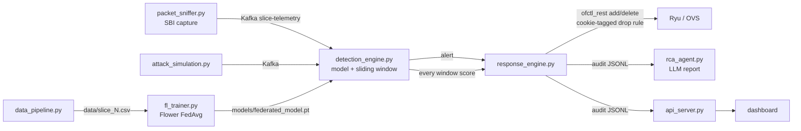

# SliceShield: AI-Driven 5G Network Slice Security

### ISP81 | Dept. of ISE

SliceShield is an end-to-end security pipeline for 5G network slices. **Federated learning** trains
one attack detector across the slices (eMBB, URLLC, mMTC) without pooling their data. A real-time
**detection engine** scores 5G SBI traffic. An **SDN response engine** (Ryu/OpenFlow) isolates an
attacked slice and re-admits it automatically when traffic is clean again. An **LLM RCA agent**
writes a forensic report for every incident.

See [`IMPROVEMENTS.md`](IMPROVEMENTS.md) for the code review and the roadmap.

## Architecture



| File | Role |
| --- | --- |
| `features.py` | **Single feature extractor** (20 features) shared by training and live capture |
| `model.py` | `SliceSecurityNet` model plus checkpoint save/load (stores the calibrated threshold) |
| `data_pipeline.py` | Builds per-slice, non-IID datasets: de-duplicated attack payloads plus realistic benign SBI/MongoDB traffic |
| `fl_trainer.py` | Flower FedAvg across slices; saves the **aggregated** model and a calibrated threshold |
| `detection_engine.py` | Runs the model on every packet, decides per sliding window, measures latency, debounces alerts |
| `response_engine.py` | Ryu REST isolation and recovery, circuit breaker, playbooks, audit log |
| `rca_agent.py` | LLM root-cause reports, with prompt-injection fencing and SUPI redaction |
| `api_server.py` | Dashboard backend: incremental logs, slice status, authenticated traffic injection |
| `attack_simulation.py` | Injects NoSQL-injection or benign traffic **through the real pipeline** |
| `packet_sniffer.py` | Captures SBI traffic (TCP 7777) and publishes features to Kafka |

## Quick start (no SDN or Kafka needed)

```bash
python -m venv .venv && source .venv/bin/activate
pip install -r requirements.txt
python run_pipeline.py --train-only                                  # data + federated training
SLICESHIELD_RYU_ENABLED=0 python run_pipeline.py --skip-train --skip-data   # demo replay
pytest -q
```

The demo replays benign SBI traffic on all three slices and injects NoSQL-injection bursts. You will
see alerts, isolation, re-admission after clean windows, and a summary with measured detection latency.
Remove `SLICESHIELD_RYU_ENABLED=0` when Ryu is running.

## Full live setup (Ubuntu 22.04+, everything on one machine)

| Terminal | Task | Command |
| --- | --- | --- |
| 1 | SDN controller | `ryu-manager ryu.app.ofctl_rest ryu.app.simple_switch_13` |
| 2 | Mininet | `sudo mn --topo single,3 --mac --switch ovsk --controller remote` |
| 3 | Kafka | `docker compose up -d` |
| 4 | Detection and response | `python run_pipeline.py --skip-train --skip-data --mode kafka` |
| 5 | Forensics | `export GROQ_API_KEY=...; python rca_agent.py` |
| 6 | Dashboard API | `python api_server.py` (prints the API key for the dashboard) |
| 7 | Packet sniffer | `sudo python3 packet_sniffer.py --interface s1-eth1 --broker localhost:9093` |

Then open `5g_security_demo_dashboard.html`, paste the API key, and use the buttons. They send traffic
through Kafka to the model. A slice turns **red** only if the model flags it, and turns **green** again
when it is re-admitted.

**Split VM/laptop setup:** run Kafka on the laptop with `HOST_IP=<laptop LAN IP> docker compose up -d`.
Point the sniffer at `--broker <laptop IP>:9093`, and set `RYU_URL=http://<vm ip>:8080` for the pipeline.

### Configuration (environment variables)

| Variable | Default | Purpose |
| --- | --- | --- |
| `KAFKA_BROKER` | `localhost:9093` | Kafka bootstrap server |
| `RYU_URL` / `RYU_DPID` | `http://localhost:8080` / `1` | Ryu ofctl_rest endpoint and switch |
| `SLICESHIELD_RYU_ENABLED` | `1` | `0` = log SDN actions without a controller |
| `SLICESHIELD_MODEL` | `models/federated_model.pt` | Model checkpoint |
| `SLICESHIELD_API_KEY` | random per run | Key for `POST /api/attack` |
| `FL_ENGINE` | `auto` | `flower` (Ray simulation) or `local` (in-process FedAvg) |
| `RCA_LLM_URL` / `RCA_LLM_MODEL` | Groq / `llama-3.1-8b-instant` | Any OpenAI-compatible endpoint, e.g. a local Ollama |

## Slice mapping

| Slice | Name | Source subnet (sniffer) | Switch port |
| --- | --- | --- | --- |
| 0 | eMBB | 10.10.0.0/24 | 1 |
| 1 | URLLC | 10.20.0.0/24 | 2 |
| 2 | mMTC | 10.30.0.0/24 | 3 |

## Known limitations

- Benign training traffic is **generated**, and `malicious_data.csv` is labelled per capture, so it
  contains some normal-looking packets. The reported F1 (~0.94) is on held-out data from the same sources. A labelled
  Open5GS/free5GC + UERANSIM capture is needed for real-world numbers (roadmap 3.1).
- The model only knows one attack family (NoSQL injection against the NRF/UDR). DDoS and lateral
  movement need new training data.
- The sniffer parses plaintext HTTP/1.1. HTTP/2 frames are flagged, but HPACK is not decoded, and TLS traffic is out of reach.
